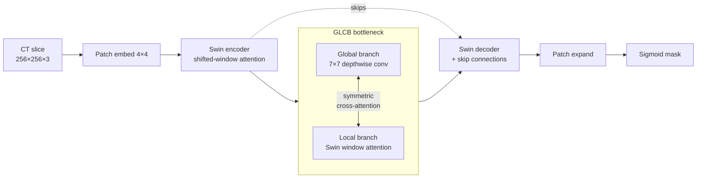

# Swin-UNet + GLCB — Liver Tumor Segmentation on LiTS 2017

> A Swin-Transformer U-Net with a novel **Global-Local Consensus Bottleneck (GLCB)** that fuses a large-kernel convolutional global branch with shifted-window attention through symmetric cross-attention, for liver and tumor segmentation in CT slices.

   

## Results — tumor-only segmentation (validation, 11,728 CT slices)

| Metric | Value |
|---|---|
| **Dice coefficient** | **0.516** |
| IoU (Jaccard) | 0.448 |
| Tumor recall | 0.827 |
| Tumor precision | 0.702 |
| Pixel accuracy | 99.25%* |
| Parameters | 416K |

\* Tumor pixels are < 2% of a CT slice, so pixel accuracy is dominated by background; **Dice and IoU are the meaningful metrics**.

Per-epoch training history: [`results/training_tumor_log.csv`](results/training_tumor_log.csv) (val Dice 0.39 → 0.52 over 10 epochs).

## The problem

- **Extreme class imbalance** — tumors are < 2% of the CT volume; plain cross-entropy collapses to background.
- **Scale variation** — tumors range from < 5 mm to > 10 cm, so a single receptive field misses one end.
- **Ambiguous boundaries** — cysts and tumors can share HU intensity values without contrast.

## Architecture



**GLCB — Global-Local Consensus Block (key contribution)**
- **Global branch:** tokens are reshaped to a spatial map and processed with a large-kernel (7×7) depthwise convolution, capturing liver-wide context at bottleneck resolution.
- **Local branch:** residual shifted-window self-attention preserves patch-level texture and boundary detail.
- **Consensus:** each branch queries the other via symmetric cross-attention before fusion, enlarging the receptive field without losing transformer precision.

**Training setup**
- Loss: Dice + (weighted) BCE composite — Dice handles imbalance, BCE keeps probabilities calibrated.
- Optimizer: Adam, lr = 1e-4, XLA JIT; checkpoint on best validation Dice.
- Memory-efficient config (window 4×4, patch 4×4, small embedding width) fits on a single 16 GB T4.

## Repository structure

```
swin-unet-glcb-liver-tumor-segmentation/
├── notebooks/
│   ├── 01_swinunet_glcb_liver.ipynb          # first Swin-UNet + GLCB model (liver + tumor)
│   ├── 02_swinunet_glcb_tumor_only.ipynb     # ⭐ final tumor-only model (results above)
│   ├── 03_inference_visualization.ipynb      # load trained model, predict & visualise masks
│   └── baselines/
│       └── nnunet_v2_baseline.ipynb          # nnU-Net v2 baseline
├── weights/best_tumor_swinunet.keras          # best checkpoint (val Dice 0.516)
├── results/training_tumor_log.csv
├── docs/SwinUNet_GLCB_Presentation.pptx
└── requirements.txt
```

## Getting started

Developed on **Kaggle (Tesla T4, 16 GB)**.

1. Download the [LiTS 2017 dataset](https://competitions.codalab.org/competitions/17094) (PNG-slice versions are available on Kaggle) and point `image_dir` / `mask_dir` in the config cell to it.
2. `pip install -r requirements.txt`
3. Run `notebooks/02_swinunet_glcb_tumor_only.ipynb` to train, or load the provided checkpoint:

```python
import tensorflow as tf
# the custom layers / loss are defined in the notebook — run those cells first
model = tf.keras.models.load_model("weights/best_tumor_swinunet.keras", custom_objects={...})
```

## Key takeaways

1. The GLCB bottleneck expands the receptive field via a global conv branch while keeping Swin attention's precision.
2. Dice + BCE is essential: BCE alone collapses to background, Dice alone is poorly calibrated.
3. Accuracy is misleading for tumor segmentation — report Dice / IoU.

## References

- H. Cao et al., *Swin-Unet: Unet-like Pure Transformer for Medical Image Segmentation*, ECCVW 2022 — [arXiv:2105.05537](https://arxiv.org/abs/2105.05537)
- Z. Liu et al., *Swin Transformer*, ICCV 2021 — [arXiv:2103.14030](https://arxiv.org/abs/2103.14030)
- P. Bilic et al., *The Liver Tumor Segmentation Benchmark (LiTS)*, Medical Image Analysis 2023 — [arXiv:1901.04056](https://arxiv.org/abs/1901.04056)
- F. Isensee et al., *nnU-Net*, Nature Methods 2021 — [arXiv:1809.10486](https://arxiv.org/abs/1809.10486)
- O. Ronneberger et al., *U-Net*, MICCAI 2015 — [arXiv:1505.04597](https://arxiv.org/abs/1505.04597)

## Author

**Jatothu Arun** — [@Arun7113](https://github.com/Arun7113)
